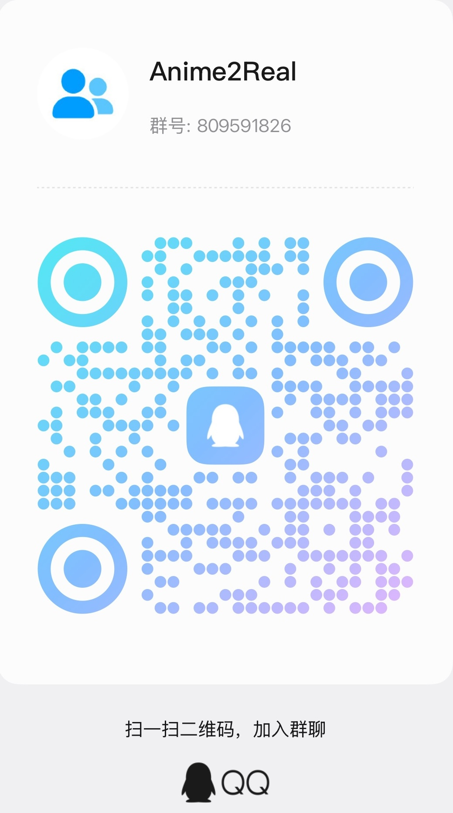

# Anime2Real

**Break through the dimensional barrier!**

Bringing anime characters into the real world with AI.

<a href="./README.md">简体中文</a> ｜ <a href="./README.ja.md">日本語</a> ｜ <a href="./README.en.md">English</a>

Our current flagship project is **Chii (小叽 / ちぃ)** from *Chobits* — a complete open-source chain from voice dataset and voice cloning to dialogue models and a desktop mascot.

## Projects

### Dataset

| Repository | Description |
| --- | --- |
| [Chobits-Chii-Voice](https://github.com/Anime2Real/Chobits-Chii-Voice) | Chii voice dataset (CV: Rie Tanaka): extracted from all 24 TV episodes, 487 segments (~21.4 minutes), manually annotated and fully re-listened · [🤗 Dataset](https://huggingface.co/datasets/chenxin199305/Chobits-Chii-Voice) |

### Models & Services

| Repository | Description |
| --- | --- |
| [Chobits-Chii-TTS](https://github.com/Anime2Real/Chobits-Chii-TTS) | Chii text-to-speech model: fine-tuned GPT-SoVITS v2Pro, weights released · [🤗 Model](https://huggingface.co/chenxin199305/Chobits-Chii-TTS) |
| [Chobits-Chii-ASR](https://github.com/Anime2Real/Chobits-Chii-ASR) | Chii speech recognition service: Fun-ASR-Nano-2512 deployment + OpenAI-compatible facade, with Qwen3-ASR switchover reserved |

### Applications

| Repository | Description |
| --- | --- |
| [Chobits-Chii-Mascot-Release](https://github.com/Anime2Real/Chobits-Chii-Mascot-Release) | Public release channel for the AI desktop mascot Chii: release artifacts and auto-update metadata |

### Plugins

| Repository | Description |
| --- | --- |
| [Chobits-Chii-DSH](https://github.com/Anime2Real/Chobits-Chii-DSH) | Chii skin plugin for the DeepSeek Harness (DSH) Web UI: neutral warm palette + Polaroid-style photo wall · `dsh-plugin` |
| [Chobits-Chii-Kimi](https://github.com/Anime2Real/Chobits-Chii-Kimi) | Chii theme plugin for Kimi Code CLI: warm cream, warm ink and low-saturation rose palette, with light and dark themes and automatic plugin sync |

## Community

<table width="100%">
<thead>
<tr>
<th align="center" width="50%">QQ</th>
<th align="center" width="50%">Discord</th>
</tr>
</thead>
<tbody>
<tr>
<td width="50%" valign="top" align="center">

Join our QQ group <strong>Anime2Real</strong> (group number: 809591826) — scan the QR code to join:

</td>
<td width="50%" valign="top" align="center">

Join the Discord server <strong>Anime2Real's Server</strong> — currently limited to 10 members. We welcome fans who genuinely love Chii and are willing to share constructive feedback.

</td>
</tr>
</tbody>
</table>

## Disclaimer

The copyright of the original anime and audio belongs to their respective rights holders. All projects under this organization are for study and research only; please do not use them for commercial purposes.
