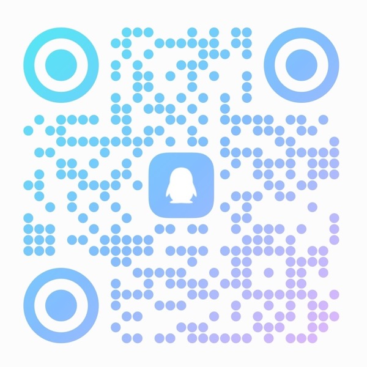

	
	<h1>Anime2Real</h1>
	
<b>Break through the dimensional barrier!</b>

	
Bringing anime characters into the real world with AI — an open-source chain from voice and persona to visuals and real-world embodiment.

	

		<a href="./README.md">简体中文</a> ｜ <a href="./README.ja.md">日本語</a> ｜ <a href="./README.en.md">English</a>
	

	

		
		
		
		
	

> 💖 If Anime2Real's projects help you, please give the relevant repositories a Star — your support helps more people discover us.

## 🌌 Mission

> **Break the dimensional barrier and bring characters into the real world.**

Anime2Real is an open-source organization turning characters from static designs into interactive presences. From voice data and voice cloning to persona dialogue and visual driving, and gradually toward real-world embodiments such as desktop, mobile, and robots, we are building a complete, reproducible, and extensible open-source chain.

- **A complete chain**: data, voice, persona, visuals, and embodiments connect with each other instead of being scattered pieces.
- **Open and reproducible**: code, data, and models are shared whenever possible to support research and further development.
- **Respect for creators**: all projects are for study and research only and claim no rights to the original works.

## 🏗️ What We Build

<table>
<thead>
<tr>
<th align="center" width="190">01 · Data</th>
<th align="center" width="190">02 · Voice</th>
<th align="center" width="190">03 · Persona</th>
<th align="center" width="190">04 · Visuals</th>
<th align="center" width="190">05 · Embodiment</th>
</tr>
</thead>
<tbody>
<tr>
<td align="center">Voice collection &amp; annotation</td>
<td align="center">Speech synthesis / recognition</td>
<td align="center">Dialogue &amp; persona design</td>
<td align="center">Live2D / motion driving</td>
<td align="center">Desktop / mobile / robots</td>
</tr>
</tbody>
</table>

Each module works on its own, and together they form a complete character pipeline.

## 🌐 Official Website

[**anime2real.cn**](https://anime2real.cn/) is Anime2Real's official website: follow the full pipeline's progress, download the Mascot and LiveTalk desktop apps, browse the open-source models and plugins, and learn about the official voice service.

## 📦 Projects

These are the currently public repositories. More modules will be opened up gradually after security and compliance reviews.

### 🎙️ Data

<table>
<thead>
<tr>
<th align="left" width="250">Repository</th>
<th align="left" width="720">Description</th>
</tr>
</thead>
<tbody>
<tr>
<td valign="top"><a href="https://github.com/Anime2Real/Chobits-Chii-Voice">Chobits-Chii-Voice</a></td>
<td valign="top">Character voice dataset: extracted from all 24 episodes, 487 segments (~21.4 minutes), manually annotated and fully re-listened · <a href="https://huggingface.co/datasets/chenxin199305/Chobits-Chii-Voice">🤗 Dataset</a></td>
</tr>
</tbody>
</table>

### 🧠 Models & Services

<table>
<thead>
<tr>
<th align="left" width="250">Repository</th>
<th align="left" width="720">Description</th>
</tr>
</thead>
<tbody>
<tr>
<td valign="top"><a href="https://github.com/Anime2Real/Chobits-Chii-TTS">Chobits-Chii-TTS</a></td>
<td valign="top">Character text-to-speech model: fine-tuned GPT-SoVITS v2Pro, weights released · <a href="https://huggingface.co/chenxin199305/Chobits-Chii-TTS">🤗 Model</a></td>
</tr>
<tr>
<td valign="top"><a href="https://github.com/Anime2Real/Chobits-Chii-ASR">Chobits-Chii-ASR</a></td>
<td valign="top">Speech recognition service: Fun-ASR-Nano-2512 deployment + OpenAI-compatible facade, with Qwen3-ASR switchover reserved</td>
</tr>
</tbody>
</table>

### 🖥️ Applications

<table>
<thead>
<tr>
<th align="left" width="250">Repository</th>
<th align="left" width="720">Description</th>
</tr>
</thead>
<tbody>
<tr>
<td valign="top"><a href="https://github.com/Anime2Real/Chobits-Chii-Mascot-Release">Chobits-Chii-Mascot-Release</a></td>
<td valign="top">Desktop release channel for the AI character: release artifacts and auto-update metadata</td>
</tr>
<tr>
<td valign="top"><a href="https://github.com/Anime2Real/Chobits-Chii-LiveTalk-Release">Chobits-Chii-LiveTalk-Release</a></td>
<td valign="top">Release channel and download page for the voice-first LiveTalk desktop app: macOS / Windows / Linux installers and auto-update metadata · <a href="https://anime2real.github.io/Chobits-Chii-LiveTalk-Release/">🌐 Download</a></td>
</tr>
</tbody>
</table>

### 🧩 Plugins

<table>
<thead>
<tr>
<th align="left" width="250">Repository</th>
<th align="left" width="720">Description</th>
</tr>
</thead>
<tbody>
<tr>
<td valign="top"><a href="https://github.com/Anime2Real/Chobits-Chii-DSH">Chobits-Chii-DSH</a></td>
<td valign="top">Theme plugin for the DeepSeek Harness (DSH) Web UI: neutral warm palette + Polaroid-style photo wall · <code>dsh-plugin</code></td>
</tr>
<tr>
<td valign="top"><a href="https://github.com/Anime2Real/Chobits-Chii-Kimi">Chobits-Chii-Kimi</a></td>
<td valign="top">Theme plugin for Kimi Code CLI: warm cream, warm ink and low-saturation rose palette, with light and dark themes and automatic plugin sync</td>
</tr>
<tr>
<td valign="top"><a href="https://github.com/Anime2Real/Chobits-Chii-Claude">Chobits-Chii-Claude</a></td>
<td valign="top">Theme plugin for Claude Code: warm cream, warm ink and low-saturation rose palette, with light and dark themes · <code>claude-plugin</code></td>
</tr>
</tbody>
</table>

## 💬 Community

If you truly love anime, join our community (QQ or Discord) to talk about characters, models, and what comes next.

<table width="100%">
<tr>
<td width="50%" valign="top" align="center">

<strong>QQ Group</strong> 
Group 809591826

Scan to join

</td>
<td width="50%" valign="top" align="center">

<strong>Discord</strong> 
Anime2Real's Server

Scan or click to join

</td>
</tr>
</table>

## 📄 License & Disclaimer

- The code, data, and models in each repository follow the `LICENSE` in that repository.
- The copyright of the original anime, characters, and audio belongs to their respective rights holders. All projects under this organization are for study and research only; please do not use them for commercial purposes.
- Related projects will be taken down if the rights holders so request.
