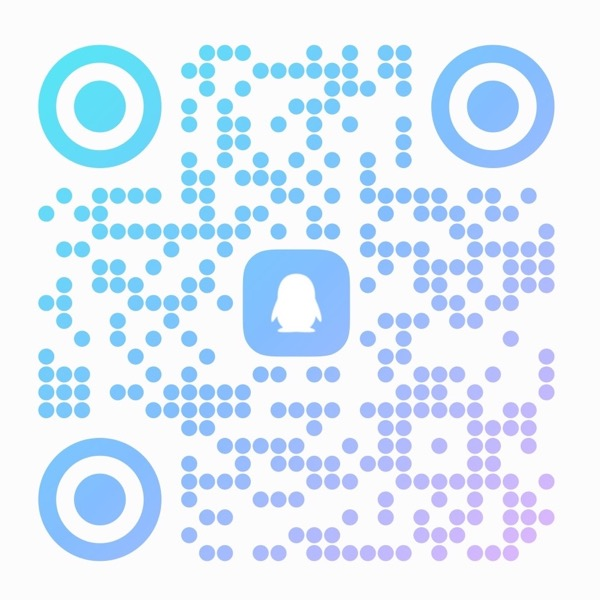

	
	<h1>Anime2Real</h1>
	
<b>次元の壁を超えよう！</b>

	
AI の力で、二次元のキャラクターを現実へ —— 声、人格、姿、そしてデスクトップからロボットまで、現実世界へ広がるソース公開（source-available）のチェーン。

	

		<a href="./README.md">简体中文</a> ｜ <a href="./README.ja.md">日本語</a> ｜ <a href="./README.en.md">English</a>
	

	

		
		
		
		
	

> 💖 Anime2Real のプロジェクトがお役に立ったら、ぜひ関連リポジトリで Star をお願いします —— あなたの応援が、より多くの人に届くきっかけになります。

## 🌌 ミッション

> **次元の壁を超え、キャラクターを現実へ。**

Anime2Real は、キャラクターを静的な設定から対話できる存在へ変えるソース公開組織です。音声データと声質クローンから、人格対話、姿の駆動、デスクトップやモバイル、そしてロボットなどの実体へと段階的に広げながら、再現可能で拡張しやすいソース公開のチェーンを構築しています。

- **一貫したチェーン**：データ、声、人格、姿、プラットフォームがつながり、断片的な寄せ集めではありません。
- **オープンで再現可能**：コード、データ、モデルをできる限り公開し、研究や二次開発を容易にします。
- **創作への敬意**：すべてのプロジェクトは学習・研究目的であり、原作の著作権を一切主張しません。

## 🏗️ 私たちが作っているもの

<table>
<thead>
<tr>
<th align="center" width="190">01 · データ</th>
<th align="center" width="190">02 · 声</th>
<th align="center" width="190">03 · 人格</th>
<th align="center" width="190">04 · 姿</th>
<th align="center" width="190">05 · プラットフォーム</th>
</tr>
</thead>
<tbody>
<tr>
<td align="center">音声の収集・注釈</td>
<td align="center">音声合成 / 認識</td>
<td align="center">対話と人格設定</td>
<td align="center">Live2D / モーション</td>
<td align="center">デスクトップ / モバイル / ロボット</td>
</tr>
</tbody>
</table>

各モジュールは単独でも使え、組み合わせることでキャラクターの一貫したチェーンになります。

## 🌐 公式サイト

[**anime2real.cn**](https://anime2real.cn/) は Anime2Real の公式サイトです。キャラクター・パイプラインの進捗、Mascot / LiveTalk デスクトップアプリのダウンロード、公開済みのモデルとプラグイン、公式音声サービスをまとめて確認できます。

## 📦 プロジェクト一覧

以下は現在公開しているリポジトリです。その他のモジュールは、セキュリティとコンプライアンスの評価が完了次第、順次公開予定です。

### 🎙️ データ

<table>
<thead>
<tr>
<th align="left" width="250">リポジトリ</th>
<th align="left" width="720">概要</th>
</tr>
</thead>
<tbody>
<tr>
<td valign="top"><a href="https://github.com/Anime2Real/Chobits-Chii-Voice">Chobits-Chii-Voice</a></td>
<td valign="top">キャラクター音声データセット：アニメ全 24 話から抽出、487 セグメント約 21.4 分、人手によるアノテーション＋全数再聴取 · <a href="https://huggingface.co/datasets/chenxin199305/Chobits-Chii-Voice">🤗 Dataset</a></td>
</tr>
</tbody>
</table>

### 🧠 モデルとサービス

<table>
<thead>
<tr>
<th align="left" width="250">リポジトリ</th>
<th align="left" width="720">概要</th>
</tr>
</thead>
<tbody>
<tr>
<td valign="top"><a href="https://github.com/Anime2Real/Chobits-Chii-TTS">Chobits-Chii-TTS</a></td>
<td valign="top">キャラクター音声合成モデル：GPT-SoVITS v2Pro をファインチューニング、重みを公開済み · <a href="https://huggingface.co/chenxin199305/Chobits-Chii-TTS">🤗 Model</a></td>
</tr>
<tr>
<td valign="top"><a href="https://github.com/Anime2Real/Chobits-Chii-ASR">Chobits-Chii-ASR</a></td>
<td valign="top">音声認識サービス：Fun-ASR-Nano-2512 をデプロイ＋OpenAI 互換フロントを提供、Qwen3-ASR への切り替えを想定</td>
</tr>
</tbody>
</table>

### 🖥️ アプリケーション

<table>
<thead>
<tr>
<th align="left" width="250">リポジトリ</th>
<th align="left" width="720">概要</th>
</tr>
</thead>
<tbody>
<tr>
<td valign="top"><a href="https://github.com/Anime2Real/Chobits-Chii-Mascot-Release">Chobits-Chii-Mascot-Release</a></td>
<td valign="top">AI キャラクターのデスクトップ向け公開リリースチャンネル：Release 成果物と自動更新メタデータ</td>
</tr>
<tr>
<td valign="top"><a href="https://github.com/Anime2Real/Chobits-Chii-LiveTalk-Release">Chobits-Chii-LiveTalk-Release</a></td>
<td valign="top">音声デスクトップアプリ LiveTalk の公開リリースチャンネルとダウンロードページ：macOS / Windows / Linux インストーラーと自動更新メタデータ · <a href="https://anime2real.github.io/Chobits-Chii-LiveTalk-Release/">🌐 ダウンロード</a></td>
</tr>
</tbody>
</table>

### 🧩 プラグイン

<table>
<thead>
<tr>
<th align="left" width="250">リポジトリ</th>
<th align="left" width="720">概要</th>
</tr>
</thead>
<tbody>
<tr>
<td valign="top"><a href="https://github.com/Anime2Real/Chobits-Chii-DSH">Chobits-Chii-DSH</a></td>
<td valign="top">DeepSeek Harness (DSH) Web UI 向けテーマプラグイン：ニュートラルで暖色系の配色＋ポラロイド風フォトウォール · <code>dsh-plugin</code></td>
</tr>
<tr>
<td valign="top"><a href="https://github.com/Anime2Real/Chobits-Chii-Kimi">Chobits-Chii-Kimi</a></td>
<td valign="top">Kimi Code CLI 向けテーマプラグイン：ウォームクリーム、ウォームインク、低彩度ローズの配色。ライト／ダーク 2 種類のテーマとプラグイン自動同期を搭載</td>
</tr>
<tr>
<td valign="top"><a href="https://github.com/Anime2Real/Chobits-Chii-Claude">Chobits-Chii-Claude</a></td>
<td valign="top">Claude Code 向けテーマプラグイン：ウォームクリーム、ウォームインク、低彩度ローズの配色。ライト／ダーク 2 種類のテーマ · <code>claude-plugin</code></td>
</tr>
</tbody>
</table>

## 💬 コミュニティ

二次元を本当に愛するあなた、ぜひコミュニティ（QQ または Discord）に参加して、キャラクターやモデル、これからの展開について語り合いましょう。

<table width="100%">
<tr>
<td width="50%" valign="top" align="center">

<strong>QQ グループ</strong> 
グループ 809591826

QR コードで参加

</td>
<td width="50%" valign="top" align="center">

<strong>Discord</strong> 
Anime2Real's Server

QR コードまたはクリックで参加

</td>
</tr>
</table>

## 📄 ライセンスと免責事項

- **ソース公開であり、OSI オープンソースではありません**：Anime2Real は「厳格な非商用 + デュアルライセンス」を採用しています。コードは PolyForm Noncommercial 1.0.0、データ・モデル重み・設計は CC BY-NC-SA 4.0 です。
- **商用利用には別途ライセンスが必要です**：有償製品、有償サービス、SaaS、商用学習などは、各リポジトリの `COMMERCIAL.md` からお問い合わせください。
- **過去のバージョン**：以前に MIT / Apache-2.0 / CC BY-NC-SA で公開されたバージョンは、そのバージョンについて従来の条件が有効です。
- **第三者の権利**：原作アニメ、キャラクター、声優の声、第三者素材の権利は各権利者に帰属します。Anime2Real はこれらの権利を許諾しません。
- 詳細は [LICENSING.md](../LICENSING.md)、コントリビュート前に [CLA.md](../CLA.md) をご確認ください。
