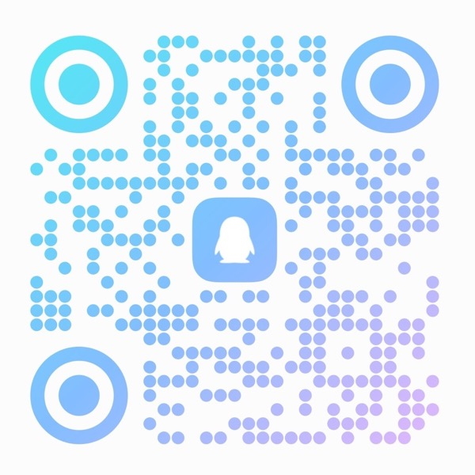

	
	<h1>Anime2Real</h1>
	
<b>次元の壁を超えよう！</b>

	
AI の力で、二次元のキャラクターを現実へ —— 声、人格、姿、そしてデスクトップからロボットまで、現実世界へ広がるオープンソースのチェーン。

	

		<a href="./README.md">简体中文</a> ｜ <a href="./README.ja.md">日本語</a> ｜ <a href="./README.en.md">English</a>
	

	

		
		
		
		
		
	

> 💖 Anime2Real のプロジェクトがお役に立ったら、ぜひ関連リポジトリで Star をお願いします —— あなたの応援が、より多くの人に届くきっかけになります。

## 🌌 ミッション

> **次元の壁を超え、キャラクターを現実へ。**

Anime2Real は、キャラクターを静的な設定から対話できる存在へ変えるオープンソース組織です。音声データと声質クローンから、人格対話、姿の駆動、デスクトップやモバイル、そしてロボットなどの実体へと段階的に広げながら、再現可能で拡張しやすいオープンソースのチェーンを構築しています。

- **一貫したチェーン**：データ、声、人格、姿、プラットフォームがつながり、断片的な寄せ集めではありません。
- **オープンで再現可能**：コード、データ、モデルをできる限り公開し、研究や二次開発を容易にします。
- **創作への敬意**：すべてのプロジェクトは学習・研究目的であり、原作の著作権を一切主張しません。

## 🏗️ 私たちが作っているもの

| 01 · データ | 02 · 声 | 03 · 人格 | 04 · 姿 | 05 · プラットフォーム |
| :---: | :---: | :---: | :---: | :---: |
| 音声の収集・注釈 | 音声合成 / 認識 | 対話と人格設定 | Live2D / モーション | デスクトップ / モバイル / ロボット |

各モジュールは単独でも使え、組み合わせることでキャラクターの一貫したチェーンになります。

## 📦 プロジェクト一覧

以下は現在公開しているリポジトリです。その他のモジュールは、セキュリティとコンプライアンスの評価が完了次第、順次公開予定です。

### 🎙️ データ

| リポジトリ | 概要 |
| --- | --- |
| [Chobits-Chii-Voice](https://github.com/Anime2Real/Chobits-Chii-Voice) | キャラクター音声データセット：アニメ全 24 話から抽出、487 セグメント約 21.4 分、人手によるアノテーション＋全数再聴取 · [🤗 Dataset](https://huggingface.co/datasets/chenxin199305/Chobits-Chii-Voice) |

### 🧠 モデルとサービス

| リポジトリ | 概要 |
| --- | --- |
| [Chobits-Chii-TTS](https://github.com/Anime2Real/Chobits-Chii-TTS) | キャラクター音声合成モデル：GPT-SoVITS v2Pro をファインチューニング、重みを公開済み · [🤗 Model](https://huggingface.co/chenxin199305/Chobits-Chii-TTS) |
| [Chobits-Chii-ASR](https://github.com/Anime2Real/Chobits-Chii-ASR) | 音声認識サービス：Fun-ASR-Nano-2512 をデプロイ＋OpenAI 互換フロントを提供、Qwen3-ASR への切り替えを想定 |

### 🖥️ アプリケーション

| リポジトリ | 概要 |
| --- | --- |
| [Chobits-Chii-Mascot-Release](https://github.com/Anime2Real/Chobits-Chii-Mascot-Release) | AI キャラクターのデスクトップ向け公開リリースチャンネル：Release 成果物と自動更新メタデータ |

### 🧩 プラグイン

| リポジトリ | 概要 |
| --- | --- |
| [Chobits-Chii-DSH](https://github.com/Anime2Real/Chobits-Chii-DSH) | DeepSeek Harness (DSH) Web UI 向けテーマプラグイン：ニュートラルで暖色系の配色＋ポラロイド風フォトウォール · `dsh-plugin` |
| [Chobits-Chii-Kimi](https://github.com/Anime2Real/Chobits-Chii-Kimi) | Kimi Code CLI 向けテーマプラグイン：ウォームクリーム、ウォームインク、低彩度ローズの配色。ライト／ダーク 2 種類のテーマとプラグイン自動同期を搭載 |

## 💬 コミュニティ

キャラクター、モデル、そしてこれからの展開について、ぜひコミュニティで語り合いましょう。

<table width="100%">
<tr>
<td width="50%" valign="top" align="center">

<strong>QQ グループ</strong> 
Anime2Real · 809591826

QR コードで参加

</td>
<td width="50%" valign="top" align="center">

<strong>Discord</strong> 
Anime2Real's Server

QR コードまたはクリックで参加

</td>
</tr>
</table>

Discord は 10 名までの限定です。二次元を本当に愛し、前向きなフィードバックをくださる方を歓迎します。

## 📄 ライセンスと免責事項

- 各リポジトリのコード、データ、モデルは、そのリポジトリ内の `LICENSE` に従います。
- 原作アニメ、キャラクター、音声の著作権は各権利者に帰属します。本組織のすべてのプロジェクトは学習・研究目的のみであり、商用利用はご遠慮ください。
- 権利者からの要請があった場合、関連プロジェクトは公開を取り下げます。
