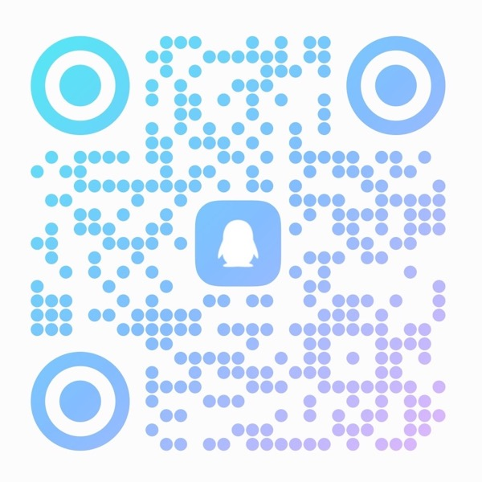

	
	<h1>Anime2Real</h1>
	
<b>打破次元壁！次元の壁を超える！</b>

	
用 AI 把二次元角色带到现实 —— 从声音、人格、形象到现实载体的完整开源链路。

	

		<a href="./README.md">简体中文</a> ｜ <a href="./README.ja.md">日本語</a> ｜ <a href="./README.en.md">English</a>
	

	

		
		
		
		
		
	

> 💖 如果 Anime2Real 的项目对你有帮助，欢迎给相关仓库点个 Star —— 你的支持能让更多人发现我们。

## 🌌 使命

> **打破次元壁，让角色真正走进现实。**

Anime2Real 是一个开源组织，致力于把「角色」从静态设定变成可交互的存在：从语音数据与声音克隆，到人格对话、形象驱动，再到桌面、移动端，并逐步走向机器人等实体载体，构建一条完整、可复现、可扩展的开源链路。

- **完整链路**：数据、声音、人格、形象与载体彼此衔接，而不是零散拼装。
- **开源可复现**：代码、数据与模型尽量公开，方便研究与二次开发。
- **尊重创作**：所有项目仅供学习与研究，不以任何形式主张原作品版权。

## 🏗️ 我们在构建什么

| 01 · 数据 | 02 · 声音 | 03 · 人格 | 04 · 形象 | 05 · 载体 |
| :---: | :---: | :---: | :---: | :---: |
| 语音采集与标注 | 语音合成 / 识别 | 对话与人格设定 | Live2D / 动作驱动 | 桌面 / 移动端 / 机器人 |

每个模块都可以单独使用，也可以组合成完整的角色链路。

## 📦 项目一览

以下为当前公开仓库，更多模块会在完成安全与合规评估后逐步开放。

### 🎙️ 数据

| 仓库 | 简介 |
| --- | --- |
| [Chobits-Chii-Voice](https://github.com/Anime2Real/Chobits-Chii-Voice) | 角色语音数据集：动画全 24 话提取，487 段约 21.4 分钟，人工标注 + 全量复听 · [🤗 Dataset](https://huggingface.co/datasets/chenxin199305/Chobits-Chii-Voice) |

### 🧠 模型与服务

| 仓库 | 简介 |
| --- | --- |
| [Chobits-Chii-TTS](https://github.com/Anime2Real/Chobits-Chii-TTS) | 角色语音合成模型：GPT-SoVITS v2Pro 微调，权重已发布 · [🤗 Model](https://huggingface.co/chenxin199305/Chobits-Chii-TTS) |
| [Chobits-Chii-ASR](https://github.com/Anime2Real/Chobits-Chii-ASR) | 语音识别服务：Fun-ASR-Nano-2512 部署 + OpenAI 兼容门面，预留 Qwen3-ASR 切换 |

### 🖥️ 应用

| 仓库 | 简介 |
| --- | --- |
| [Chobits-Chii-Mascot-Release](https://github.com/Anime2Real/Chobits-Chii-Mascot-Release) | AI 角色的桌面端发布渠道：Release 产物与自动更新元数据 |

### 🧩 插件

| 仓库 | 简介 |
| --- | --- |
| [Chobits-Chii-DSH](https://github.com/Anime2Real/Chobits-Chii-DSH) | DeepSeek Harness (DSH) Web UI 主题插件：中性暖调配色 + 拍立得照片墙 · `dsh-plugin` |
| [Chobits-Chii-Kimi](https://github.com/Anime2Real/Chobits-Chii-Kimi) | Kimi Code CLI 主题插件：暖奶油、暖墨与低饱和玫瑰配色，含明暗两套主题与插件自动同步 |

## 💬 社区

欢迎加入社区，一起讨论角色、模型与未来载体。

<table width="100%">
<tr>
<td width="50%" valign="top" align="center">

<strong>QQ 群</strong> 
Anime2Real · 群号 809591826

扫码加入

</td>
<td width="50%" valign="top" align="center">

<strong>Discord</strong> 
Anime2Real's Server

扫码或点击加入

</td>
</tr>
</table>

Discord 社区已开放，欢迎真正热爱二次元、愿意提供积极反馈的同好。

## 📄 许可与声明

- 各仓库的代码、数据与模型以其仓库内的 `LICENSE` 为准。
- 原始动画、角色与音频的版权归其权利方所有。本组织下的所有项目仅供学习与研究使用，请勿用于商业用途。
- 若权利方提出要求，相关项目将被下架。
